<div align="center">



# ⚡ Awesome ML Feature Stores

<a href="https://github.com/ishandutta2007/Awesome-Awesome-Awesome"></a><a href="https://discord.gg/jc4xtF58Ve"></a>
[](https://github.com/ishandutta2007/Awesome-ML-Feature-Stores/stargazers)
[](https://github.com/ishandutta2007/Awesome-ML-Feature-Stores/network/members)
[](LICENSE)
[](https://github.com/ishandutta2007/Awesome-ML-Feature-Stores/commits/main)
<a href="https://github.com/ishandutta2007"></a>

<p align="center">
  <strong>A curated directory of SaaS platforms, cloud-native services, and open-source GitHub repositories for Machine Learning Feature Stores, Real-Time Feature Serving, Point-in-Time Correctness, and MLOps Data Infrastructure.</strong>
</p>

---

</div>

## 📑 Table of Contents

- [🌟 Overview & Architectural Blueprint](#-overview--architectural-blueprint)
- [📊 Sector Overview & Market Dynamics](#-sector-overview--market-dynamics)
- [🏢 SaaS & Cloud-Hosted Feature Stores](#-saas--cloud-hosted-feature-stores)
- [💻 Open-Source GitHub Projects](#-open-source-github-projects)
- [🎯 Core Failure Modes Solved by Feature Stores](#-core-failure-modes-solved-by-feature-stores)
- [🧠 Evaluation Framework: When Do You Actually Need One?](#-evaluation-framework-when-do-you-actually-need-one)
- [🤝 How to Contribute](#-how-to-contribute)
- [💖 Support & Sponsorship](#-support--sponsorship)
- [📈 Star History](#-star-history)
- [📜 Disclaimer](#-disclaimer)

---

## 🌟 Overview & Architectural Blueprint

A **Machine Learning Feature Store** is a specialized data management architecture that bridges the gap between raw data engineering pipelines and production machine learning models. Feature stores address three critical operational challenges in enterprise AI:

1. **⏱️ Point-in-Time Correctness (Time-Travel / AS-OF Joins)**: Preventing future data from inadvertently leaking into historical training sets by joining features strictly as they existed at label-event time.
2. **🛡️ Training-Serving Skew Prevention**: Enforcing identical feature computation logic across batch training workflows (PySpark, SQL, Snowflake) and real-time online inference pipelines (REST APIs, gRPC, microservices).
3. **⚡ Dual-Storage Online & Offline Serving**: Materializing features into high-throughput, low-cost analytical storage (Delta Lake, BigQuery, S3/Parquet) for offline model training alongside ultra-low latency key-value storage (Redis, DynamoDB, Bigtable) for sub-10ms real-time inference.

```
┌─────────────────────────────────┐           ┌─────────────────────────────────┐
│   🌊 Streaming Event Sources    │           │    📦 Batch Storage Sources     │
│   (Kafka, Kinesis, Pulsar)      │           │   (Snowflake, BigQuery, Delta)  │
└────────────────┬────────────────┘           └────────────────┬────────────────┘
                 │                                             │
                 ▼                                             ▼
┌───────────────────────────────────────────────────────────────────────────────┐
│                        ⚙️ FEATURE STORE ENGINE & REGISTRY                      │
│   • Declarative Feature Views & Schemas      • Automated Point-in-Time Joins   │
│   • Data Quality & Drift Monitoring          • Upstream / Downstream Lineage   │
└───────────────────────┬─────────────────────────────────────┬─────────────────┘
                        │                                     │
         (Low Latency Push Sync)                 (Batch Historical Materialization)
                        │                                     │
                        ▼                                     ▼
        ┌───────────────────────────────┐     ┌───────────────────────────────┐
        │       ⚡ ONLINE STORE         │     │        📦 OFFLINE STORE       │
        │   (Redis, DynamoDB, Bigtable) │     │    (Parquet, S3, Lakehouse)   │
        └───────────────┬───────────────┘     └───────────────┬───────────────┘
                        │                                     │
                        ▼                                     ▼
        ┌───────────────────────────────┐     ┌───────────────────────────────┐
        │   🚀 Online Real-Time Serving │     │   🎓 Model Training Dataset   │
        │   (Sub-10ms Model Scoring API)│     │   (Zero-Leakage Training Data)│
        └───────────────────────────────┘     └───────────────────────────────┘
```

---

## 📊 Sector Overview & Market Dynamics

- **Estimated Market Size**: The global Machine Learning Feature Store market is currently valued at approximately **$1.56 Billion** and is projected to surge to over **$13.4 Billion by 2034**, expanding at a Compound Annual Growth Rate (**CAGR of ~26.8%**) driven by mainstream real-time enterprise AI, retrieval-augmented generation (RAG), and mission-critical MLOps deployments.
- **Market Dynamics & Fragmentation**: The market exhibits **moderate-to-high consolidation** around major cloud hyperscalers and lakehouse platforms (Google Cloud Vertex AI, AWS SageMaker, Databricks, and Snowflake) which capture standardized batch and analytical feature pipelines. However, specialized pure-play platforms (Tecton, Chalk, and Hopsworks) sustain substantial competitive moats in high-throughput, sub-10ms real-time streaming architectures, complex graph relationships, and real-time fraud/recommendation engines where generalist data warehouses incur excessive latency.

---

## 🏢 SaaS & Cloud-Hosted Feature Stores

*The premier enterprise managed and cloud-native feature store solutions, ranked in descending order by **Company Size (Valuation / Market Cap / Revenue)**.*

| Platform | Company Size (Valuation / Revenue) | Description & Key Capabilities | Starting Price | Free Tier / Free Trial Limits |
| :--- | :--- | :--- | :--- | :--- |
| **[Google Vertex AI Feature Store](https://cloud.google.com/vertex-ai/docs/featurestore)** | **~$2.1 Trillion** Market Cap / ~$350 Billion Annual Revenue *(Alphabet Inc., Nasdaq: GOOGL)* | Fully managed GCP feature store featuring BigQuery source federation, declarative Feature Views, automatic drift monitoring, and optimized online serving nodes for low-latency retrieval without operating Redis clusters. | **$0.45 per node-hour** for optimized online serving nodes (or BigQuery direct feature fetch at **$5.00/TB scanned**); online storage from **$0.20/GB/month**; batch ingestion at standard BigQuery/Vertex storage rates. | **$300 free credits for 90 days** for new Google Cloud accounts; BigQuery perpetual free tier includes **10 GB active storage** and **1 TB query analysis** per month free forever. |
| **[AWS SageMaker Feature Store](https://aws.amazon.com/sagemaker/feature-store/)** | **~$2.0 Trillion** Market Cap / ~$600+ Billion Annual Revenue *(Amazon.com Inc., Nasdaq: AMZN)* | Purpose-built feature repository natively embedded in SageMaker Studio; orchestrates high-throughput online feature groups for real-time inference and offline stores in Amazon S3 for reproducible model training datasets. | **$0.25 per million write requests** and **$0.14 per million read requests**; online storage at **$0.10 per GB-month**; offline storage billed at standard Amazon S3 rates (**$0.023/GB-month**). | **2-month free trial** via AWS Free Tier (includes **10 million write requests/month**, **25 million read requests/month**, and **10 GB online storage** for 60 days); plus AWS startup credits upon application. |
| **[Snowflake Feature Store](https://docs.snowflake.com/en/developer-guide/snowpark-ml/feature-store/overview)** | **~$50 Billion** Market Cap / ~$3.6 Billion Annual Revenue *(Snowflake Inc., NYSE: SNOW)* | Native feature store built directly into the Snowflake Data Cloud via Snowpark ML; delivers declarative Python feature definitions, automatic point-in-time joins, and zero-data-movement governance across analytical features. | **$2.00 per credit** *(Standard Edition)* or **$3.00 per credit** *(Enterprise Edition)*; consumed at 1 credit/hour on an X-Small virtual compute warehouse. | **30-day free trial** with **$400 in free usage credits** across all Snowflake data warehousing, Snowpark ML, and Feature Store services. |
| **[Databricks Feature Store](https://docs.databricks.com/en/machine-learning/feature-store/index.html)** | **~$43 Billion** Valuation / ~$2.4+ Billion Annual Revenue *(Privately held, backed by a16z, Baillie Gifford & Fidelity)* | Lakehouse-integrated feature platform governed by Unity Catalog; automates feature lineage tracking, point-in-time correction (AS-OF joins), and Lakebase low-latency online serving with automatic serverless scaling. | **$0.07 to $0.40 per DBU-hour** *(Serverless Lakebase from ~$0.07/DBU; Jobs Compute from ~$0.15/DBU; All-Purpose compute from ~$0.40/DBU)* plus underlying cloud VM infrastructure. | **14-day free trial** of full enterprise Databricks platform with unlimited DBUs; permanent access to **Databricks Community Edition** (free forever with 1 micro-cluster 15GB RAM, single-node). |
| **[Tecton](https://www.tecton.ai/)** | **~$1.0 Billion** Valuation *(Privately held, Series C, backed by Sequoia Capital & Andreessen Horowitz)* | Enterprise managed real-time feature platform built by the original creators of Feast; features native Kafka/Kinesis streaming ingestion, automated feature monitoring/drift detection, and sub-10ms p99 SLAs for fraud and recommendation engines. | **~$5,000/month** entry production tier *(starts at ~$60,000/year platform contract on AWS, GCP, or Snowflake)* scaling with feature compute units and read/write QPS. | **14-day guided sandbox trial** *(Tecton Quickstart developer environment with pre-configured feature repository and live web console)* or 30-day guided enterprise PoC upon sales qualification. |
| **[Hopsworks (Managed Cloud)](https://www.hopsworks.ai/)** | **~$150 Million** Valuation *(Privately held, European scale-up backed by Industrifonden & Inventure)* | Fully managed European cloud AI platform integrating an enterprise feature store, built-in model registry, training dataset generator, vector search index for RAG, and streaming feature groups. | **$0.35 per compute credit** *(Pay-as-you-go SaaS: ~$0.175/CPU-hour, ~$0.0175/GB-hour RAM, $0.50/GB/month online store, $0.03/GB/month offline store)*. | **Permanent Free Plan ($0/month):** 1 project with capped compute/storage, community support, full Feature Store & Model Registry access with no credit card required; plus **14-day free trial with $400 credits** for Enterprise Cloud. |
| **[Chalk](https://chalk.ai/)** | **~$150 Million** Valuation *(Privately held, Series A backed by General Catalyst & Unusual Ventures)* | Developer-first real-time feature store and AI data platform with a Python-native DSL, sub-5ms low latency query engine, unified stream/batch resolution, and virtual feature computation. | **$0.85 per standard credit** *(AWS Marketplace pay-as-you-go model covering compute, real-time serving, and sync inside customer VPC)*. | **14-day interactive free sandbox pilot** with complete CLI and web dashboard access; permanent local development environment supported via open-source Python library. |

---

## 💻 Open-Source GitHub Projects

*The leading open-source feature stores, feature transformation engines, and lineage platforms, ranked in descending order by **GitHub Star Count**.*

- 🌟 **[Feast](https://github.com/feast-dev/feast)** [](https://github.com/feast-dev/feast/stargazers)  
  **The open-source standard for feature stores, cloud-agnostic and code-first.** Features are declaratively authored in Python, decoupling model training and inference pipelines from backend infrastructure. Operates a dual-store architecture with an offline store (Snowflake, BigQuery, Redshift, Spark, DuckDB) for historical extraction and a low-latency online store (Redis, DynamoDB, Bigtable, PostgreSQL) for real-time serving. Includes point-in-time joins (`get_historical_features`) with AS-OF semantics to prevent label leakage, dbt model ingestion, and push-based online materialization.

- 🌟 **[Apache Hamilton](https://github.com/apache/hamilton)** [](https://github.com/apache/hamilton/stargazers)  
  **Declarative, general-purpose micro-framework for feature engineering and data transformations.** Created originally at Stitch Fix and now an Apache Software Foundation incubator project, Hamilton structures feature logic as a directed acyclic graph (DAG) of Python functions. Provides automatic lineage tracking, unit-testable feature nodes, catalog generation, and seamless integration alongside Feast, Spark, and DuckDB.

- 🌟 **[Feature-Engine](https://github.com/feature-engine/feature_engine)** [](https://github.com/feature-engine/feature_engine/stargazers)  
  **Scikit-learn compatible Python library for feature engineering and transformation pipelines.** Implements comprehensive transformers for variable encoding, discretization, imputation, outlier handling, datetime extraction, and mathematical combinations. Essential upstream feature extraction library frequently paired with feature stores for reproducible pre-storage transformations.

- 🌟 **[Feathr](https://github.com/feathr-ai/feathr)** [](https://github.com/feathr-ai/feathr/stargazers)  
  **Enterprise open-source feature store platform originally developed by LinkedIn**, now hosted under the Linux Foundation AI & Data (LF AI & Data). Offers declarative feature definitions with built-in aggregations (sliding windows, groupings), automated point-in-time joins, feature lineage graph visualization, and multi-cloud deployment templates for Azure, AWS, and GCP.

- 🌟 **[Hopsworks Community](https://github.com/logicalclocks/hopsworks)** [](https://github.com/logicalclocks/hopsworks/stargazers)  
  **Comprehensive open-source feature store and data-intensive AI platform.** Features a unified Feature Store API for Python and PySpark, structured Feature Groups with primary keys and event timestamps, training dataset generators across formats (TFRecord, Parquet, CSV), online feature vector serving (`get_online_feature_vector`), and integrated model registry and vector search.

- 🌟 **[Chronon](https://github.com/airbnb/chronon)** [](https://github.com/airbnb/chronon/stargazers)  
  **Airbnb's open-source end-to-end feature engineering and serving platform.** Powers Airbnb's production machine learning ecosystem by unifying batch data (Hive/Spark) and streaming events (Kafka) into consistently computed features. Automates complex time-window aggregations, point-in-time joins, backfilling, and low-latency online serving with zero skew between offline training and online scoring.

- 🌟 **[Feathub](https://github.com/alibaba/feathub)** [](https://github.com/alibaba/feathub/stargazers)  
  **Stream-batch unified feature store for real-time machine learning developed by Alibaba.** Leverages Apache Flink and Apache Spark compute engines to execute unified feature extraction across streaming and offline sources, ensuring identical feature computation logic across real-time inference and batch training.

- 🌟 **[Butterfree](https://github.com/quintoandar/butterfree)** [](https://github.com/quintoandar/butterfree/stargazers)  
  **Open-source Spark-based feature store framework developed by QuintoAndar.** Provides an expressive Python DSL for ETL feature pipelines, automated historical time-series extraction, data quality validation, and dual-sink loading into Cassandra/Redis (online) and S3/Delta (offline).

- 🌟 **[ByteHub](https://github.com/bytehub-ai/bytehub)** [](https://github.com/bytehub-ai/bytehub/stargazers)  
  **Lightweight, developer-friendly open-source feature store optimized for time-series data.** Built on top of pandas and cloud object storage (S3/GCS/Azure Blob), ByteHub provides simple feature registration, versioning, and point-in-time extraction without requiring heavy infrastructure or complex distributed orchestrators.

---

## 🎯 Core Failure Modes Solved by Feature Stores

| Failure Mode | Symptoms Without a Feature Store | How Feature Stores Resolve It |
| :--- | :--- | :--- |
| **💥 Training-Serving Skew** | Offline model achieves 98% accuracy in notebook evaluation, but plummets to 64% in production inference due to disparate SQL vs. Python logic. | Features are defined once declaratively and pushed to both offline and online storage destinations simultaneously. |
| **🕰️ Data Leakage (Lookahead Bias)** | Training labels are joined with modern feature values from future timestamps, generating artificially inflated offline validation metrics. | Point-in-time (`AS-OF`) joins guarantee that feature values reflect exact historical reality at the instant each observation label occurred. |
| **🔁 Feature Duplication** | Five data science teams independently compute and materialize "30-day customer spend" with slightly different SQL aggregation rules. | Centralized searchable feature catalog with metadata, schema contracts, freshness indicators, and lineage tracking. |
| **🐢 Serving Latency Mismatch** | Real-time models require complex aggregates (e.g., 90-day transaction counts) that cannot be calculated at request time without breaking SLAs. | Pre-materialized sliding window computations continuously push updated values to low-latency key-value online stores (Redis, DynamoDB). |

---

## 🧠 Evaluation Framework: When Do You Actually Need One?

```
                                  Does your ML application require:
                                1. Features shared across multiple models?
                                2. Time-window aggregations (e.g. 30d sum)?
                                3. Real-time inference with <20ms latency?
                                                 │
                                 ┌───────────────┴───────────────┐
                                 ▼                               ▼
                              [ YES ]                         [ NO ]
                                 │                               │
            Do you already run Databricks / Snowflake?           ▼
                                 │                     Do NOT over-engineer!
                 ┌───────────────┴───────────────┐     Simple SQL scripts, dbt,
                 ▼                               ▼     or request-time payloads
              [ YES ]                         [ NO ]   are sufficient.
                 │                               │
                 ▼               Need sub-10ms real-time streaming?
         Adopt native module                     │
       (Databricks Feature Store        ┌────────┴────────┐
       or Snowflake Feature Store)      ▼                 ▼
                                     [ YES ]           [ NO ]
                                        │                 │
                                        ▼                 ▼
                              Tecton / Chalk /     Feast / Hopsworks /
                              Managed Hopsworks    In-house Parquet
```

---

## 🤝 How to Contribute

Contributions are warmly welcomed! Help keep this repository the definitive guide for data scientists and ML platform engineers:

1. 🍴 **Fork** this repository.
2. 🌿 **Create a new branch**: `git checkout -b feat/add-feature-store`
3. ✏️ **Add your entry** adhering to the existing tabular or bulleted format with verified starting prices, specific trial limits, and official documentation links.
4. 🔍 For additional curated developer lists, explore [Awesome Awesome Awesome](https://github.com/ishandutta2007/Awesome-Awesome-Awesome).
5. 📬 **Submit a Pull Request** with a concise summary of why the addition is valuable to the community.

---

## 💖 Support & Sponsorship

Thank you for exploring and using this repository! If you find this curated directory helpful for your machine learning workflows, data architecture, or production MLOps engineering, please consider supporting the project:

- ⭐ **Star this repository** on GitHub to show your appreciation and help others discover it.
- 🔀 **Fork & Share** it with your colleagues, MLOps engineers, and data science community.
- ☕ **Buy me a coffee / Sponsor**: You can sponsor ongoing maintenance and open-source updates via the [GitHub Sponsor Dashboard](https://github.com/sponsors/ishandutta2007).

---

## 📈 Star History

[](https://star-history.dera.page/#ishandutta2007/Awesome-ML-Feature-Stores&type=date&legend=top-left)

---

## 📜 Disclaimer

- This repository is a **community-curated directory** provided strictly for educational, architectural research, and platform evaluation purposes.
- Feature stores introduce significant architectural trade-offs: while managed platforms (Tecton, Chalk, Vertex AI, SageMaker, Databricks) offload cluster operations, self-hosted open-source deployments (Feast, Hopsworks, Chronon) require dedicated engineering resources to orchestrate materialization pipelines and manage online stores (Redis, DynamoDB).
- Pricing figures, free tier limits, and corporate market valuations represent public information as of early 2026 and may change over time; always confirm directly with vendor documentation before making procurement decisions.

---

<div align="center">

**Built with ⚡ for ML Platform Engineers, Data Scientists, and MLOps Architects.**  
*Let's make feature stores point-in-time correct, zero-skew, and operationally transparent.*

</div>